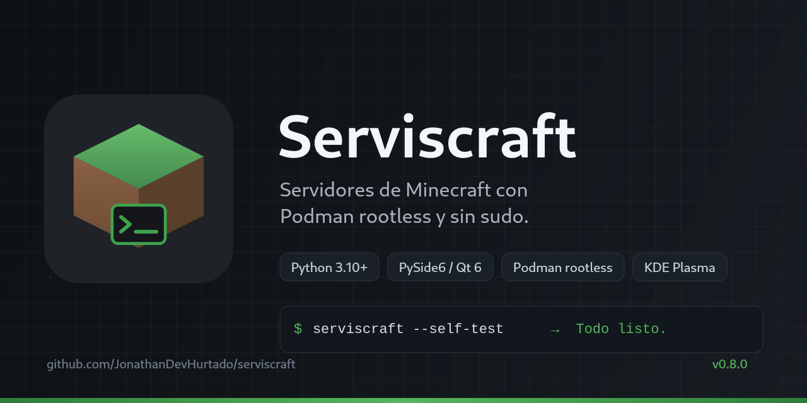
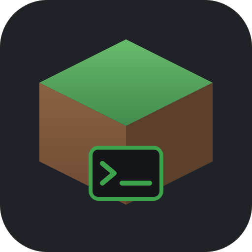
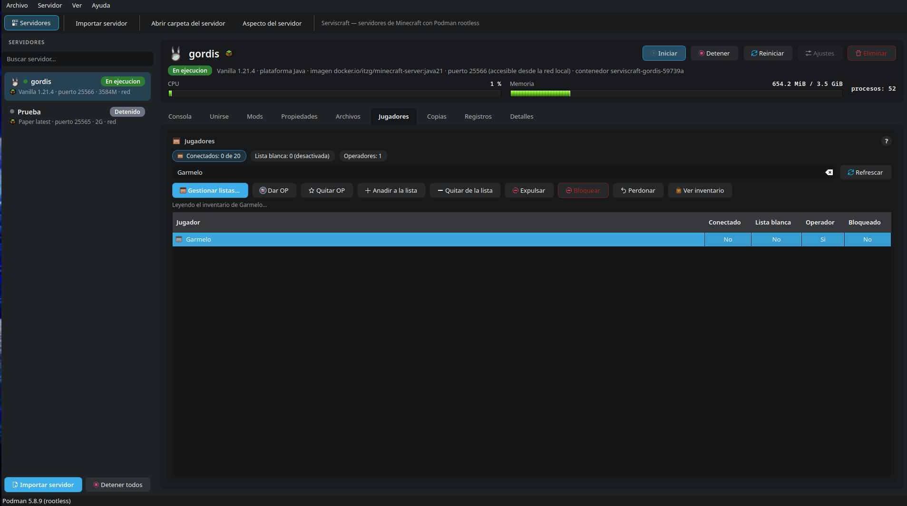
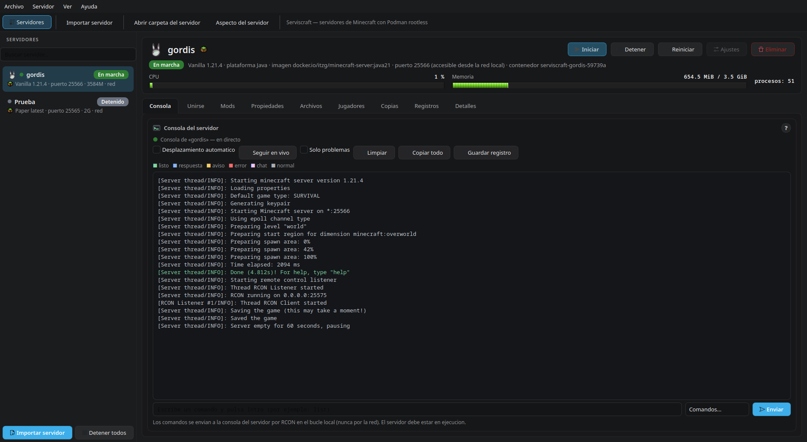
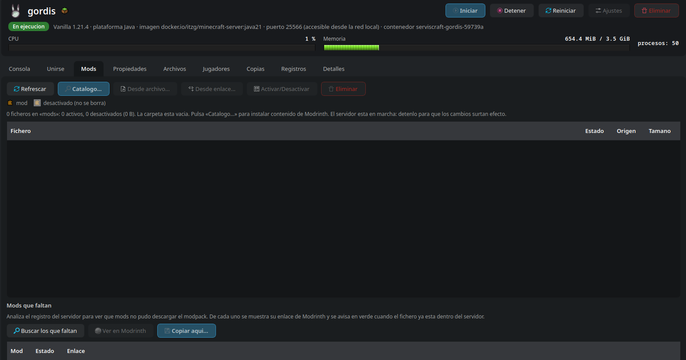
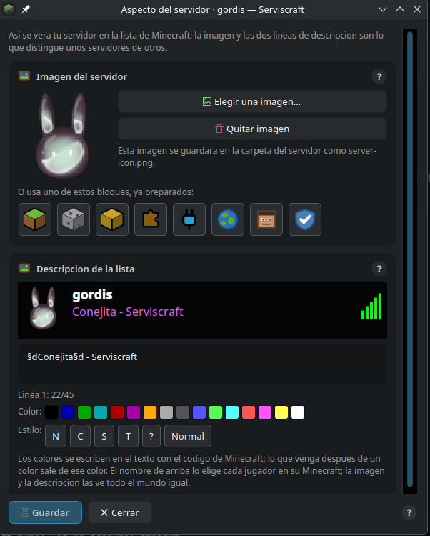
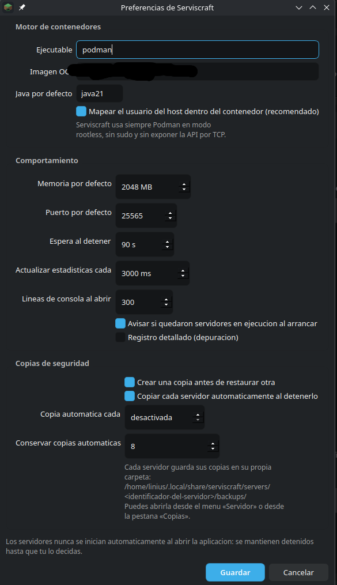

<p align="center">
  <a href="capturas/banner.png">
    
  </a>
</p>

<h1 align="center">
  
  Serviscraft
</h1>

<p align="center">
  <strong>Gestor gráfico de servidores de Minecraft sobre Podman rootless, para KDE Plasma.</strong>
</p>

<p align="center">
  
  
  
  
  
  
  
</p>

Serviscraft crea y administra servidores de Minecraft (**Vanilla, Paper, Fabric,
Forge y modpacks de Modrinth**) como contenedores Podman **sin privilegios**, con
una interfaz de escritorio moderna que se integra en el menú de aplicaciones de
KDE y funciona tanto en X11 como en Wayland.

<p align="center">
  <em>Interfaz en español, tema claro y oscuro, sin usar nunca <code>sudo</code>.</em>
</p>

## Por qué Serviscraft

La idea es tener **algo parecido a Aternos, pero en tu ordenador y con tus
datos**. Eso obligó a tomar decisiones que se notan por dentro y por fuera:

- **Sin `sudo` y sin demonio con privilegios.** Todo corre con tu usuario en
  Podman rootless. La API de Podman nunca se expone por TCP.
- **El servidor es de verdad.** Mundo, plugins o mods, consola, RCON y copias
  reales. Nada de esconder el juego detrás de una capa opaca.
- **Tus datos, en tu casa.** Mundos, configuración y copias viven en
  `~/.local/share/serviscraft`, siempre tuyos.
- **Actualizar no puede borrar.** `META_VERSION`, migraciones explícitas y
  copias manuales que nunca se limpian solas.
- **Fácil para quien solo quiere jugar.** Y auditable para quien quiere leer el
  código: núcleo sin Qt, una sola puerta a Podman y [776 pruebas](tests/).

La historia completa, decisión por decisión y problema por problema, está en
[`docs/historia.md`](docs/historia.md).

<p align="center">
  <a href="capturas/01-jugadores.png">
    
  </a>
</p>

<p align="center">
  <em>Jugadores, listas y barras de CPU y RAM de un servidor real, en tema oscuro.</em>
</p>

## Qué hace

| Función | Descripción |
| --- | --- |
| Crear servidores | Vanilla, Paper, Fabric o Forge; eliges versión de Minecraft, memoria (RAM), puerto y nombre. Paper viene seleccionado por defecto y Java se recomienda solo. La imagen OCI se descarga automáticamente. |
| Importar servidores | Trae un servidor que ya tenías: su carpeta o el **`.zip` de Aternos**. Reconoce tipo, versión, mundo, plugins/mods, puerto y origen (Aternos, exaroton, Minehut…), copia los datos sin tocar el original y no crea el contenedor hasta el primer inicio. |
| Modpacks | Instala modpacks de **Modrinth** (Cobblemon, Better MC…) con sus mods, configuraciones y cargador. La búsqueda enseña cargador, versiones de Minecraft, descargas y fecha, y se filtra por cargador o por lado. |
| Ciclo de vida | Iniciar, detener, reiniciar y eliminar servidores. Los servidores **nunca arrancan solos**: al abrir la aplicación siguen detenidos. |
| Ajustes del servidor | Secciones de identidad, Minecraft, recursos y red: cambia **versión, Java, memoria (RAM)** y puerto de un servidor existente sin perder el mundo. La versión se elige siempre de la lista publicada. |
| Java correcto | Serviscraft conoce qué Java necesita cada versión de Minecraft: si un servidor antiguo arrancó con el Java equivocado (y murió al instante), lo **detecta, explica el motivo y lo corrige** cambiando la etiqueta de Java y recreando el contenedor, sin tocar el mundo. |
| Consola en tiempo real | Se sigue la salida del contenedor en vivo, con estado en color, **leyenda**, filtro **solo problemas**, copiar/guardar y comandos por RCON. |
| `server.properties` | Editor gráfico de las propiedades, con las claves que gestiona Serviscraft protegidas. |
| Plugins, mods y mundos | **Catálogo Modrinth** para buscar e instalar con un clic (con verificación SHA-512), importar `.jar`, descargar por URL y gestionar varios mundos. Cada proyecto se ve con **su icono** en la lista, como en Prism Launcher. |
| Pestaña Mods | Todo el contenido en un sitio: activar y desactivar **sin borrar**, ver si un mod viene del modpack o es tuyo, eliminarlo, y añadirlo desde el catálogo, un `.jar` local o una URL. |
| Mods que faltan | Analiza el registro, muestra el enlace de **Modrinth** de cada mod que el modpack no pudo descargar, lo marca en verde cuando ya está y copia el `.jar` dentro del servidor. |
| Registros | Pestaña con los ficheros de `logs` y la salida del contenedor, filtro por texto y seguimiento automático. |
| Unirse | Pestaña con los pasos concretos y la dirección lista para copiar (**Java**, este equipo y **Bedrock**), botón para consultar tu **IP pública** y guía para jugar con amigos de fuera de casa. |
| Nombre para entrar | En vez de una IP, un nombre que se recuerda: **DuckDNS** gratis (`reinotrebol.duckdns.org:25565`), con comprobación de que resuelve y actualización automática de tu IP al arrancar. |
| Imagen y descripción | El icono de 64×64 y las dos líneas de descripción que se ven en la **lista de servidores de Minecraft**, con los **16 colores** del juego, paleta, vista previa de la entrada y ocho bloques ya dibujados. |
| Jugadores de Bedrock | En servidores **Paper**, activa **Geyser** y **Floodgate** con una casilla: se publica el puerto **UDP** y entran móvil, tablet y consola, sin tocar el mundo ni los mods. |
| Java o Bedrock de un vistazo | Junto al nombre del servidor aparecen dos bloques dibujados: **césped** (Java) y **piedra** (Bedrock), también en la barra lateral y en la ficha de detalles. |
| Modo de cuentas | Interruptor de **cuentas premium** (`online-mode`) con aviso de seguridad y confirmación antes de permitir clientes sin licencia. |
| Jugadores | Quién está conectado, lista blanca, operadores y bloqueados, con fichas de resumen y la cara de cada jugador. **Gestionar listas…** reúne las tres listas en una ventana y funciona también con el servidor apagado; expulsar, bloquear y perdonar, sin escribir comandos a mano. |
| Inventario del jugador | Con el servidor en marcha, **Ver inventario** enseña la mochila con la misma forma que el juego (inventario, armadura, mano secundaria y barra rápida), con **texturas de los objetos**, **la skin del jugador**, vida, comida, nivel y cantidades. Las texturas se descargan una vez y se guardan en caché; sin conexión se dibujan iconos propios. No modifica nada. |
| Copias de seguridad | Crear, **renombrar**, restaurar, exportar e importar copias; **copia automática al detener** cada servidor y copias **programadas** cada cierto tiempo; limpieza por antigüedad. |
| Estadísticas | Barras con el aspecto de la **experiencia de Minecraft**: CPU como porcentaje del equipo (nunca más del 100 %) y memoria respecto a la asignada, con el detalle de núcleos al pasar el ratón. |
| Archivos a mano | Botones y menús para abrir la carpeta de datos y la de copias de cada servidor, con la ruta siempre a la vista. |
| Varios servidores | Cada servidor es independiente, con su propio contenedor, mundo, puerto y carpeta. **Detener todos** apaga de golpe los que estén en marcha y el estado que se ve es siempre el real de Podman. |

## Tecnologías

| Tecnología | Para qué se usa | Por qué esa y no otra |
| --- | --- | --- |
| **Python 3.10+** | Lenguaje de toda la aplicación. | Lógica legible y auditable, sin dependencias de compilación, disponible en cualquier distribución. |
| **PySide6 / Qt 6** | Interfaz gráfica. | Ventana nativa en KDE, X11 y Wayland, con tema claro/oscuro y un solo lenguaje para todo el programa. |
| **Podman rootless** | Ejecutar cada servidor en su contenedor. | **Sin `sudo`, sin demonio root y sin exponer la API por TCP.** Se llama al binario con listas de argumentos, y solo se tocan contenedores `serviscraft-*`. |
| **Imagen OCI `itzg/minecraft-server`** | El servidor de Minecraft en sí. | Una imagen universal: `TYPE` elige Vanilla, Paper, Fabric o Forge y `java8/17/21/25` la versión de Java. Menos imágenes que mantener. |
| **RCON** | Consola, comandos y jugadores con el servidor encendido. | Es el protocolo del propio juego y va por `127.0.0.1`. Con el servidor apagado, las listas se editan en `whitelist.json`, `ops.json` y `banned-players.json` con el **UUID offline** de Java. |
| **API de Modrinth** | Catálogo de mods, plugins y modpacks. | Datos del proyecto (cargador, versiones de Minecraft, descargas, fecha) y **verificación SHA-512** de cada descarga. |
| **DuckDNS** | Nombre para conectarse desde fuera. | Un nombre que se recuerda (`nombre.duckdns.org:puerto`) en vez de una IP, con actualización automática al arrancar. |
| **XDG Base Directory** | Datos, configuración y caché. | Integración limpia con el escritorio; `SERVISCRAFT_HOME` permite un modo portátil. |
| **pytest + pytest-qt** | Pruebas. | **776 casos** con la ventana real en plataforma `offscreen`, sin lanzar contenedores. Una prueba verifica que `core/` no importa Qt. |
| **RPM + DEB + AppImage** | Distribución. | Paquete nativo para Fedora/KDE y para Debian/Ubuntu, y un AppImage portátil. Cada uno verifica su versión con `serviscraft --self-test`. |
| **GitHub Actions** | Integración continua. | La suite completa en cada push y en cada *pull request*. |
| **QSS sobre la paleta de KDE** | Aspecto. | Tema claro y oscuro que encaja con el escritorio, e **iconos dibujados a mano** para lo que un tema no tiene. |

## Arquitectura en 10 segundos

```
┌──────────────────────────────────────────────────────┐
│  ui/  (PySide6)   ventanas, diálogos, estilos        │
└──────────────────────────┬───────────────────────────┘
                           │  métodos y dataclasses
┌──────────────────────────▼───────────────────────────┐
│  core/  (Python puro, SIN Qt)                        │
│  manager · podman · store · backup · players · …     │
└──────────────────────────┬───────────────────────────┘
                           │  listas de argumentos
┌──────────────────────────▼───────────────────────────┐
│  podman rootless  →  contenedor itzg/minecraft-server │
└──────────────────────────────────────────────────────┘
```

- **La interfaz no ejecuta comandos**: todo pasa por `ServerManager`.
- **El estado no se inventa**: se pregunta a Podman; la ficha solo guarda la
  configuración.
- **Una ficha rota no tumba la lista**: cada servidor se carga por separado.
- El viaje completo de una orden, la estructura de carpetas y las migraciones
  están explicados en [`docs/historia.md`](docs/historia.md) y
  [`docs/desarrollo.md`](docs/desarrollo.md).

## Capturas

Todas son de la versión 0.8.0, en un escritorio KDE Plasma con tema oscuro.

| Consola en vivo | Mods y plugins |
| --- | --- |
| [](capturas/02-consola.png) | [](capturas/03-mods.png) |
| **Aspecto del servidor** (icono y MOTD) | **Preferencias** |
| [](capturas/04-aspecto.png) | [](capturas/05-preferencias.png) |

## Requisitos

- Linux con escritorio KDE Plasma (o cualquier escritorio Qt moderno), X11 o Wayland.
- **Podman** instalado y funcionando en modo **rootless** (no se usa `sudo` nunca).
- Python 3.10 o superior y PySide6 6.6 o superior.

En Fedora:

```bash
sudo dnf install podman python3-pyside6
```

Comprueba el entorno con:

```bash
serviscraft --self-test
```

## Instalación

Las versiones oficiales (RPM, DEB y AppImage) se publican en la página de
**Releases** del repositorio. También puedes construirlas desde el código.

### Paquetes (recomendado)

```bash
make rpm        # dist/serviscraft-0.8.0-1.fc44.noarch.rpm
make deb        # dist/serviscraft_0.8.0_all.deb
make appimage   # dist/Serviscraft-0.8.0-x86_64.AppImage
```

Instalar el RPM:

```bash
sudo dnf install dist/serviscraft-*.noarch.rpm
```

Instalar el `.deb`:

```bash
sudo apt install ./dist/serviscraft_*.deb
```

Ejecutar el AppImage (no necesita instalación; **Podman sigue siendo externo**):

```bash
chmod +x dist/Serviscraft-*.AppImage
./dist/Serviscraft-*.AppImage
```

### Verificar la descarga

Cada *Release* publica un fichero `SHA256SUMS-0.8.0.txt` con el hash de los tres
paquetes y del código fuente. Para comprobar que la descarga está íntegra:

```bash
sha256sum -c SHA256SUMS-0.8.0.txt
```

Y para comprobar que el entorno está listo (Podman rootless, PySide6 y la
versión correcta):

```bash
serviscraft --self-test
```

### Desde el código fuente

```bash
make venv     # crea .venv (reutiliza PySide6 del sistema)
make run      # inicia la aplicación
```

### Instalación para tu usuario (sin root)

```bash
make install-user     # lanza el script y el .desktop en ~/.local
make uninstall-user
```

Deja el lanzador en `~/.local/bin/serviscraft` (que debe estar en tu `PATH`) y la
entrada del menú; ejecuta el código de esta misma carpeta, así que no muevas el
proyecto si quieres seguir usándolo.

## Uso rápido

1. Pulsa **Nuevo servidor…**, elige tipo, versión, memoria, puerto y nombre (o
   marca *Usar un modpack de Modrinth* y elige un pack con sus filtros).
2. El servidor se crea **detenido**. Pulsa **Iniciar** cuando quieras.
3. Sigue la consola en la pestaña **Consola** y escribe comandos abajo.
4. Copia la dirección en **Unirse**, ve qué mods están activos en **Mods** y ajusta
   el resto en **Propiedades**, **Archivos**, **Jugadores** y **Copias**.
5. Si algo no arranca, mira **Registros** o pulsa **Buscar mods que faltan**.

La ventana se puede estrechar todo lo que quieras (mosaico automático de KDE,
media pantalla…): los botones pasan a la línea siguiente y los textos largos se
ajustan en varias líneas, sin recortarse ni salirse de la ventana. Si una pestaña
no cabe a lo alto, se desplaza con su propia barra.

Datos, mundos y copias se guardan en `~/.local/share/serviscraft/`, siempre en
tu carpeta personal y con tu usuario como propietario. **Cada servidor guarda sus
copias en su propia carpeta** `servers/<id>/backups/`, y la pestaña **Copias**
muestra esa ruta con un botón para abrirla.

La documentación completa está en [`docs/`](docs/):

- [`docs/instalacion.md`](docs/instalacion.md) — instalación detallada.
- [`docs/uso.md`](docs/uso.md) — guía de uso y solución de problemas.
- [`docs/seguridad.md`](docs/seguridad.md) — modelo de seguridad y cortafuegos.
- [`docs/desarrollo.md`](docs/desarrollo.md) — arquitectura, pruebas y empaquetado.
- [`docs/historia.md`](docs/historia.md) — cómo se creó, decisiones y problemas resueltos.
- [`CHANGELOG.md`](CHANGELOG.md) — qué cambió en cada versión.

## Seguridad en una frase

Serviscraft **nunca** ejecuta Podman con `sudo`, **nunca** expone la API de
Podman por TCP, **nunca** modifica el cortafuegos ni abre puertos sin tu
consentimiento, y **no borra nada** sin pedirte confirmación.

## Estado del proyecto

- **Versión estable actual:** 0.8.0 (octubre de 2026).
- **Pruebas:** 776 en verde (`pytest`, plataforma `offscreen`).
- **Desarrollo y pruebas:** Fedora 44 con KDE Plasma; la interfaz está pensada
  para X11 y Wayland.
- **Paquetes:** RPM, DEB y AppImage, todos verificados con `--self-test`.
- **Siguiente paso:** rediseño visual global tipo launcher (el resto de la
  0.8.0 está cerrado).

## Licencia

**Propietaria.** El código se publica para que se pueda **leer y auditar**, pero
no es software libre: no se permite copiarlo, modificarlo, redistribuirlo ni
usarlo en otro proyecto sin permiso por escrito. Las versiones oficiales se
pueden descargar y usar gratis para uso personal y no comercial.

Lee [`LICENSE`](LICENSE) y [`TERCEROS.md`](TERCEROS.md). Si necesitas otro tipo
de permiso, abre una consulta en el perfil de GitHub del autor.

Serviscraft no está afiliado a Mojang ni a Microsoft. «Minecraft» es una marca
de Mojang AB. Las texturas y skins se descargan en tiempo de ejecución y no se
distribuyen con el programa.
